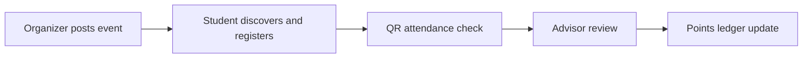

<div align="center">
  

  <p>
    
    
    
    <a href="LICENSE"></a>
  </p>
</div>

## 🎓 What it does

Pulse is a campus opportunity and activity-points platform prototype. Students browse events, register, and present a QR code for attendance; organizers and advisors have separate views for verification and approval. The backend records events, registrations, notifications, discussions, and points-ledger entries.

<p align="center"></p>

## 🔄 Event lifecycle



## 🧰 Stack

| Layer | Tools |
|---|---|
| Frontend | React 18, Vite, TypeScript, Tailwind, Framer Motion |
| API | Express, TypeScript, Bun scripts |
| Database | MongoDB/Mongoose |
| QR and UI | `html5-qrcode`, `qrcode.react`, Lucide |
| Deploy config | `render.json` |

## 🚀 Run locally

Start the backend:

```bash
git clone https://github.com/ChristopherJoshy/Pulse.git
cd pulse/backend
bun install
Copy-Item .env.example .env  # PowerShell; use cp on macOS/Linux
bun run dev
```

Start the frontend separately:

```bash
cd pulse/frontend
npm install
npm run dev
```

Configure MongoDB and the frontend API URL locally. The repository includes seeded profiles and example event material.

## 🗂️ Layout

```text
frontend/             student, organizer and advisor screens
backend/src/          Express routes, controllers and MongoDB models
copetitions  data/    sample event poster assets
code-wiki.md          implementation notes
```

## ⚠️ Authentication is demo-only

The current UI intentionally allows role switching and profile creation for demonstration. The backend endpoints load seeded profiles and create profiles; this is **not production authentication or authorization**. Do not deploy this build with real student records, personal data, or activity-point decisions until authentication, server-side role checks, and audit controls are implemented and reviewed.

## 📄 License

MIT. See [`LICENSE`](LICENSE).